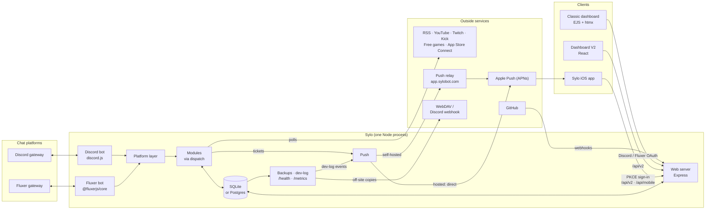

<div align="center">


# Sylo

**A multi-function Discord and Fluxer bot with a MEE6-style web dashboard.**
Add the hosted instance in one click, or self-host it with Docker or Unraid.

[](https://discord.com/oauth2/authorize?client_id=1374856793469227029)
[](https://discord.gg/GAzR9k5hhS)
[](https://github.com/Ferdinand99/Sylo/actions/workflows/test.yml)
[](https://github.com/Ferdinand99/Sylo/releases)
[](https://hub.docker.com/r/iwgamin/sylo)
[](https://hub.docker.com/r/iwgamin/sylo)
[](https://github.com/Ferdinand99/Sylo/pkgs/container/sylo)
[](https://nodejs.org)
[](LICENSE)
[](#sylo-app-ios)
[](https://sylobot.com)
[](https://roadmap.sylobot.com/roadmap)

[Add to Discord](https://discord.com/oauth2/authorize?client_id=1374856793469227029) ·
[Dashboard](https://app.sylobot.com) ·
[Self-host](#self-host) ·
[Docs](#documentation) ·
[Community](https://discord.gg/GAzR9k5hhS)

</div>

> [!IMPORTANT]
> ### 📱 Public TestFlight beta: coming soon
>
> [](#sylo-app-ios)
>
> The first public build of **Sylo – Server Manager** is waiting for Apple's beta
> review. As soon as it is approved, the link to join the beta goes here, so you
> can install it on your iPhone or iPad with the TestFlight app.

---

## What Sylo does

Sylo bundles 35 per-server **modules**. Each one is switched on and configured
from the dashboard. The bot, the dashboard and every module run in **one Node
process and one container**, and in-process sharding keeps it that way past
Discord's 2,500-server gateway limit.

| Area | Modules |
|---|---|
| **Moderation & safety** | [Moderation](docs/modules/moderation.md) (case log, warnings, auto-actions) · [Auto-moderation](docs/modules/automod.md) (can sync to Discord's native AutoMod) · [Server logging](docs/modules/logging.md) · [Verification](docs/modules/verification.md) (button or Turnstile captcha) · [Ban appeals](docs/modules/appeals.md) · [Tickets / modmail](docs/modules/tickets.md) · [Channel cleanup](docs/modules/channel-cleanup.md) · Honeypot (beta) |
| **Welcome & roles** | [Welcome & leave](docs/modules/welcome.md) · [Welcome channel](docs/modules/welcome-channel.md) · [Reaction roles & autoroles](docs/modules/roles.md) (emoji, buttons or dropdown) · [Birthdays](docs/modules/birthdays.md) |
| **Engagement** | [Leveling](docs/modules/leveling.md) (image rank cards, public leaderboard) · [Invite tracker](docs/modules/invite-tracker.md) · [Starboard](docs/modules/starboard.md) · [Polls](docs/modules/polls.md) · [Giveaways](docs/modules/giveaways.md) · [Counting](docs/modules/counting.md) · [Game stats](docs/modules/game-stats.md) (Battlefield, OSRS, RS3) |
| **Automation** | [Custom commands](docs/modules/custom-commands.md) · [Autoresponder](docs/modules/autoresponder.md) · [Auto-react](docs/modules/auto-react.md) · [Reminders](docs/modules/reminders.md) · [Sticky messages](docs/modules/sticky.md) · [AFK](docs/modules/afk.md) · [Temporary voice channels](docs/modules/temp-voice.md) |
| **Alerts** | [Twitch](docs/modules/twitch-alerts.md) · [YouTube](docs/modules/youtube-alerts.md) · [Kick](docs/modules/kick-alerts.md) · [RSS / Atom](docs/modules/rss.md) (also Reddit, Mastodon, Bluesky) · [GitHub](docs/modules/github.md) · [Free games](docs/modules/free-games.md) · [App Store Connect](docs/modules/apple-connect.md) (owner only) |
| **Insights** | [Server statistics](docs/modules/server-stats.md) (live counter channels) · [Server insights](docs/modules/insights.md) (activity charts, aggregate counts only) |

The [module index](docs/modules/README.md) has one page per module: what it
does, the permissions and intents it needs, its settings and its commands.

**Fluxer (experimental).** The same bot, modules and dashboard also run on
[Fluxer](https://fluxer.app), alone or next to Discord from one process. Fluxer
has no slash commands yet, so commands run from chat (`!ping`). See
[docs/fluxer.md](docs/fluxer.md).

> **Coming from Sylo-Fluxer?** The separate
> [Sylo-Fluxer](https://github.com/Ferdinand99/Sylo-Fluxer) fork is archived.
> Since 4.0 this repository covers Fluxer itself. Its database is not migrated
> automatically; see [Coming from Sylo-Fluxer](docs/fluxer.md#coming-from-sylo-fluxer).

## How it works



- **Bots.** `src/bot/index.js` (Discord) and `src/bot/fluxerBot.js` (Fluxer)
  feed gateway events through the platform layer (`src/platform/`) to the
  enabled modules (`src/modules/dispatch.js`).
- **Storage.** One SQLite file by default; Postgres when `DATABASE_URL` is set
  (`src/db/driver.js`, see [docs/postgres.md](docs/postgres.md)).
- **Web.** `src/web/server.js` serves both dashboards, the JSON API at
  `/api/v2`, the app's `/api/mobile`, the public pages (leaderboard,
  verification, appeals) and the GitHub webhook endpoint.
- **Push.** Ticket notifications go to APNs directly when the instance holds
  the APNs key (the hosted Sylo), otherwise through the relay on
  `app.sylobot.com` (`src/lib/push.js`, `src/web/routes/pushRelay.js`).

## Use the hosted Sylo

You don't have to run anything yourself. Sylo is a Discord-verified bot:

1. [Add Sylo to your server](https://discord.com/oauth2/authorize?client_id=1374856793469227029).
2. Sign in to the dashboard at **[app.sylobot.com](https://app.sylobot.com)**
   with Discord (or Fluxer) and turn on the modules you want.

Questions and announcements live on the
[community Discord](https://discord.gg/GAzR9k5hhS). Service status:
[status.sylobot.com](https://status.sylobot.com/status/default).

## Self-host

Sylo needs **Node.js 22+** (or Docker) and a Discord application with a bot. The
full guide, with every environment variable, the Discord application setup, a
reverse proxy, backups, upgrades, rollback and troubleshooting, is
**[docs/self-hosting.md](docs/self-hosting.md)**.

### Docker

```bash
cp .env.example .env              # set DISCORD_TOKEN and DISCORD_CLIENT_ID
docker compose up -d --build      # builds from source, data in ./data
```

Or run a prebuilt multi-arch image (`linux/amd64` + `linux/arm64`):

```bash
docker run -d --name sylo -p 3000:3000 --env-file .env \
  -v "$PWD/data:/app/data" --restart unless-stopped iwgamin/sylo:latest
```

| Tag | What it is |
|---|---|
| `iwgamin/sylo:latest`, `:X.Y.Z`, `:X.Y` ([Docker Hub](https://hub.docker.com/r/iwgamin/sylo) · [GHCR](https://github.com/Ferdinand99/Sylo/pkgs/container/sylo)) | Stable releases. What the Unraid template pulls. |
| `ghcr.io/ferdinand99/sylo:main`, `:sha-<short>` (GHCR only) | Rolling build of every push to `main`. |

### Unraid

Sylo is in **Community Applications**: search for "Sylo". The template lives in
[Ferdinand99/unraid-templates](https://github.com/Ferdinand99/unraid-templates).
Put the data directory on a real local disk (for example
`/mnt/cache/appdata/sylo`), **not** `/mnt/user`, because SQLite in WAL mode needs
working file locks. Details: [Unraid](docs/self-hosting.md#unraid) and
[SQLite on a network mount](docs/self-hosting.md#sqlite-on-a-network-mount).

### From source

```bash
git clone https://github.com/Ferdinand99/Sylo.git
cd Sylo
npm install
cp .env.example .env
npm run build:v2     # once, so the dashboard can serve /v2
npm start
```

The dashboard is then on `http://<host>:3000` (`WEB_PORT`).

### Minimal configuration

| Variable | Needed for |
|---|---|
| `DISCORD_TOKEN`, `DISCORD_CLIENT_ID` | Running on Discord (Developer Portal → Bot / General Information) |
| `FLUXER_TOKEN`, `FLUXER_CLIENT_ID` | Running on Fluxer, instead of or next to Discord ([docs/fluxer.md](docs/fluxer.md)) |
| `DISCORD_CLIENT_SECRET` | "Log in with Discord" on the dashboard. Without a client secret the dashboard runs **open** |
| `SESSION_SECRET` | Keeping logins across restarts (any long random string) |
| `DASHBOARD_URL` | The public URL behind a reverse proxy; also used for captcha and appeal links |
| `OWNER_IDS` | Your Discord user id(s); limits `/health` and the bot-wide pages to you |

At least one platform must be configured. Keep an open dashboard on `localhost`
or a trusted LAN only. Both privileged gateway intents are on by default; turn
off the ones you don't need with `INTENT_GUILD_MEMBERS=false` /
`INTENT_MESSAGE_CONTENT=false`. Everything else (alert API keys, backups,
logging, push) is optional and listed in [`.env.example`](.env.example) and the
[environment variable table](docs/self-hosting.md#environment-variables).

### Backups and monitoring

Sylo snapshots its database to `<data>/backups` before every schema migration
and on a schedule. The **Health** page lists, creates, downloads, imports and
restores snapshots. Copies can also go off-site to WebDAV (for example
Nextcloud) or a Discord webhook, optionally encrypted with
`BACKUP_ENCRYPTION_KEY`. `GET /health` returns JSON status for health checks,
and `GET /metrics` serves Prometheus metrics; a ready-made Grafana dashboard is
in [docs/grafana-dashboard.json](docs/grafana-dashboard.json). See
[Backups](docs/self-hosting.md#backups) and
[Off-site backups](docs/self-hosting.md#off-site-backups).

## Sylo app (iOS)

**Sylo – Server Manager** is a native SwiftUI app (source in
[`apps/sylo-ios`](apps/sylo-ios)) that signs in to the hosted Sylo or your own
instance and manages your servers through the same API as the new dashboard,
with push notifications for new tickets. It is in beta on TestFlight and not on
the App Store yet.

The first public TestFlight build is waiting for Apple's beta review; the join
link will be posted [at the top of this README](#readme)
once it is approved.

A self-hosted instance needs nothing extra beyond a working dashboard login
(Discord or Fluxer OAuth). Notifications reach the phone through the hosted
relay unless you set `PUSH_RELAY_URL=` to turn them off. Sign-in flow,
endpoints, tokens and permissions: [docs/mobile-app.md](docs/mobile-app.md).

## Dashboard

- **Classic dashboard.** Server-rendered EJS with a small htmx + Alpine layer,
  vendored, with no CDN. It has a sidebar server switcher, a plugin grid, a
  settings page per module and builders for embeds, reaction roles, custom
  commands and the welcome channel. Saves swap in place with a toast, and every
  page still works without JavaScript.
- **[Dashboard V2](docs/dashboard-v2.md) (beta).** A React single-page app at
  `/v2`, opt-in, using the same login and the same data. Module coverage is
  still growing.
- **Public pages.** Shareable leaderboards (`/leaderboard/:id`, `/lb/:slug`),
  member verification (`/verify`) and ban appeals (`/appeal`). These pages use
  no JavaScript framework.

## Development

```bash
npm install
cp .env.example .env     # use a separate test bot
npm run dev              # node --watch
```

Set `DISCORD_DEV_GUILD_IDS` to one or more test server ids (comma-separated) so
slash commands register instantly instead of taking up to an hour globally.

| Script | What it does |
|---|---|
| `npm test` | The `node:test` suite (no network; DB tests use a throwaway SQLite file) |
| `npm run lint` / `lint:fix` | ESLint |
| `npm run format` / `format:check` | Prettier |
| `npm run build:v2` / `dev:v2` | Build or serve the React dashboard (Vite) |
| `npm run register` | Re-sync slash commands without a restart |
| `npm run migrate-to-postgres` | Copy an SQLite install into Postgres ([docs/postgres.md](docs/postgres.md)) |

**Postgres.** SQLite is the default and what nearly every self-host should use.
CI runs the whole suite twice, once on SQLite and once on Postgres 16 with
`DATABASE_URL` set. Tests that need Postgres fail fast locally unless you point
`DATABASE_URL` at a throwaway database.

CI (`test.yml`) gates every image build. Releases are cut with
[release-please](https://github.com/googleapis/release-please) from
[Conventional Commits](https://www.conventionalcommits.org): merging its release
PR tags the version, writes [CHANGELOG.md](CHANGELOG.md) and publishes the
Docker Hub and GHCR images. Architecture, conventions and how to add a module
are in [CONTRIBUTING.md](CONTRIBUTING.md).

### Adding another game

1. Create `src/adapters/games/<game>.js` exporting an adapter with `id`,
   `titles()`, `platformsFor(title)` and
   `getPlayerStats(username, platform, { title })`. Throw the typed errors from
   `gameAdapter.js` for failures.
2. Register it in `src/adapters/games/index.js` (one `import` + `register(...)`).
3. Add a `game` choice (`<adapter>:<title>`) to `GAME_CHOICES` in
   `src/bot/commands/stats.js`, plus an embed builder if the stats shape
   differs. The shared `runStatsLookup()` helper and the cache need no changes.

## Documentation

| Page | What's in it |
|---|---|
| [docs/modules/](docs/modules/README.md) | One page per module: settings, commands, permissions, intents |
| [docs/self-hosting.md](docs/self-hosting.md) | Install, environment variables, reverse proxy, Docker, Unraid, backups, upgrades, troubleshooting |
| [docs/fluxer.md](docs/fluxer.md) | Running on Fluxer, alone or next to Discord |
| [docs/mobile-app.md](docs/mobile-app.md) | The iOS app: what an instance needs, sign-in, endpoints, notifications |
| [docs/dashboard-v2.md](docs/dashboard-v2.md) | The React dashboard (beta) |
| [docs/postgres.md](docs/postgres.md) | Optional Postgres backend and moving an SQLite install over |
| [CHANGELOG.md](CHANGELOG.md) | Every release |
| [Roadmap](https://roadmap.sylobot.com/roadmap) | What's planned; suggest features and vote |
| [sylobot.com](https://sylobot.com) | The project site |

## Privacy and security

- Message content is read only by the modules that need it and is not stored,
  except for modmail ticket transcripts. You can export
  your data with `/mydata` and delete it with `/forget`, and a server's data is
  purged when Sylo leaves it. Dashboard accounts can be deleted from the account
  page or in the app.
- The instances run by Ferdinand99 (**Sylo** and **Sylo - Test**) are covered by
  the [Privacy Policy](docs/privacy-policy.md) and
  [Terms of Service](docs/terms-of-service.md). Self-hosted instances are run by
  their own operators, who should adjust these documents if they publish their
  own.
- Found a vulnerability? Please report it privately as described in
  [SECURITY.md](SECURITY.md), not in a public issue.

## Contributing

Issues and pull requests are welcome. Read [CONTRIBUTING.md](CONTRIBUTING.md)
first: it covers setup, the architecture, the checks a PR must pass
(`npm test`, `npm run lint`, `npm run format:check`) and the commit style.

## License

[MIT](LICENSE) © Ferdinand99
