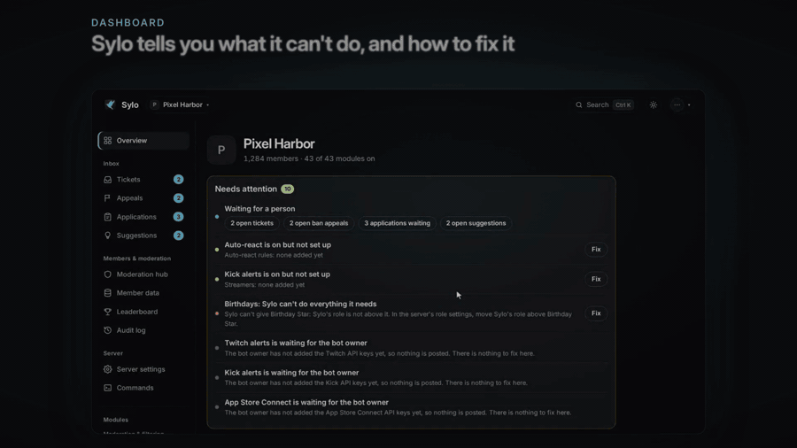
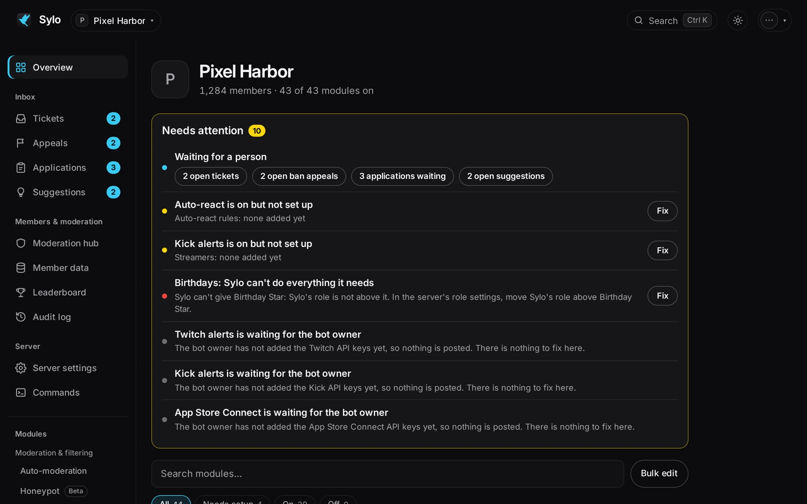
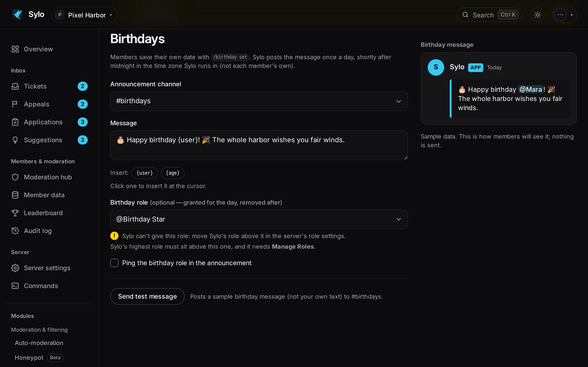
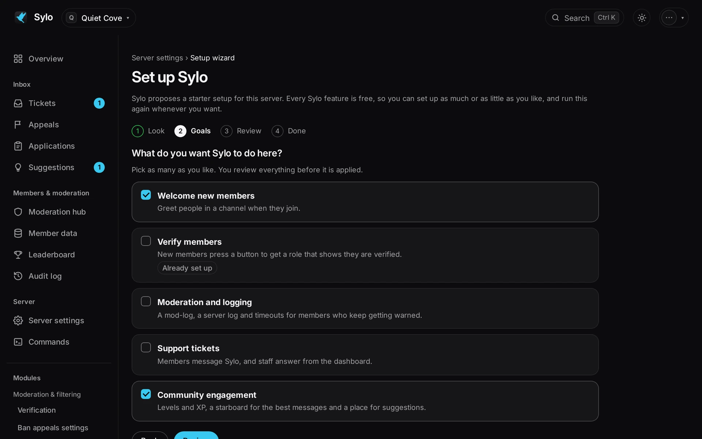
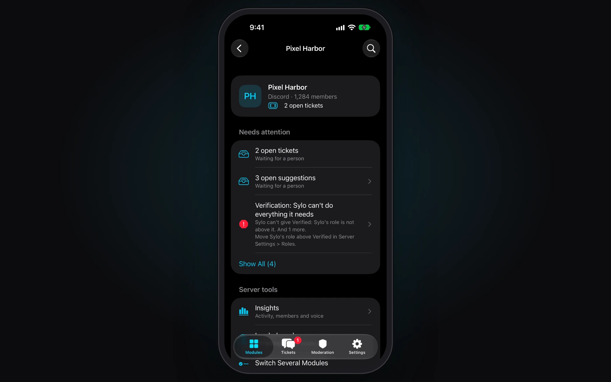
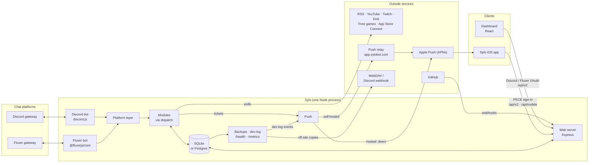

<div align="center">

<picture>
  <source media="(prefers-color-scheme: dark)" srcset="assets/brand/sylo-logo-dark.svg" />
  
</picture>

# Sylo

**A friendly Discord and Fluxer bot with a web dashboard and an iOS app.**
Moderation, tickets, welcome flows, an economy and alerts, in one place and free for every server.

[](https://github.com/Ferdinand99/Sylo/releases)
[](LICENSE)
[](#what-sylo-does)
[](docs/fluxer.md)
[](https://discord.gg/GAzR9k5hhS)

[Add to Discord](https://discord.com/oauth2/authorize?client_id=1374856793469227029) ·
[Dashboard](https://app.sylobot.com) ·
[iOS app](https://apps.apple.com/app/sylo-server-manager/id6824036901) ·
[Self-host](#self-host) ·
[Docs](#documentation) ·
[Community](https://discord.gg/GAzR9k5hhS)

<br />



</div>

## A look at Sylo

<table>
  <tr>
    <td width="50%" valign="top">
      
      <br /><sub><b>Overview.</b> Needs attention lists what is waiting for you, with a Fix button.</sub>
    </td>
    <td width="50%" valign="top">
      
      <br /><sub><b>Health check.</b> Sylo says what it cannot do and how to fix it, right at the setting.</sub>
    </td>
  </tr>
  <tr>
    <td width="50%" valign="top">
      
      <br /><sub><b>Setup wizard.</b> Pick your goals, review what Sylo proposes, then apply.</sub>
    </td>
    <td width="50%" valign="top">
      
      <br /><sub><b>iOS app.</b> Sylo – Server Manager: the same server, in your pocket.</sub>
    </td>
  </tr>
</table>

<sub>All screenshots show demo data from a made-up server.</sub>

> [!TIP]
> ### 📱 The Sylo app is on the App Store
>
> [](https://apps.apple.com/app/sylo-server-manager/id6824036901)
>
> **Sylo – Server Manager** for iPhone and iPad: manage your modules, answer
> tickets and get notified about new ones.
> Feedback is welcome in the [community Discord](https://discord.gg/GAzR9k5hhS).

## What Sylo does

Sylo bundles 43 per-server **modules**. Each one is switched on and configured
from the dashboard. Every feature is free for every server: there is no premium
tier.

- 🛡️ **Moderation and safety.** Case log, warnings and auto-actions, auto-moderation
  (it can sync to Discord's native AutoMod), server logging and channel cleanup.
- 🎫 **Tickets, appeals and applications.** Members open a ticket by DM, staff answer
  from the dashboard or the app; ban appeals and application forms get the same inbox
  treatment.
- 👋 **Welcome and verification.** Welcome and leave messages, a rich welcome channel,
  introduction cards, reaction roles and autoroles, and verification by button or captcha.
- 💰 **Economy and shop.** A server currency earned by chatting and in voice, a bank,
  paying each other, a shop with roles and custom items, plus levels with rank cards
  and a public leaderboard.
- 📣 **Alerts and community tools.** Twitch, YouTube, Kick, RSS, GitHub and free-game
  alerts, plus polls, giveaways, events, starboard, suggestions, birthdays, reminders
  and custom commands.
- 🖥️ **Dashboard and app.** A setup wizard, a Needs attention list, an audit log with
  undo, a command palette (Ctrl+K), dashboard access levels, message templates and the
  iOS app with push notifications for new tickets.

<details>
<summary><b>All 44 modules</b></summary>

| Area | Modules |
|---|---|
| **Moderation & safety** | [Moderation](docs/modules/moderation.md) (case log, warnings, auto-actions) · [Auto-moderation](docs/modules/automod.md) (can sync to Discord's native AutoMod) · [Server logging](docs/modules/logging.md) · [Verification](docs/modules/verification.md) (button or Turnstile captcha) · [Ban appeals](docs/modules/appeals.md) · [Tickets / modmail](docs/modules/tickets.md) · [Applications](docs/modules/applications.md) (forms for staff to accept or deny) · [Channel cleanup](docs/modules/channel-cleanup.md) · Honeypot (beta) |
| **Welcome & roles** | [Welcome & leave](docs/modules/welcome.md) · [Welcome channel](docs/modules/welcome-channel.md) · [Introductions](docs/modules/introductions.md) (membership cards) · [Reaction roles & autoroles](docs/modules/roles.md) (emoji, buttons or dropdown) · [Temporary roles](docs/modules/temp-roles.md) (beta) · [Birthdays](docs/modules/birthdays.md) |
| **Engagement** | [Leveling](docs/modules/leveling.md) (image rank cards, public leaderboard) · [Economy](docs/modules/economy.md) (currency and shop, beta) · [Invite tracker](docs/modules/invite-tracker.md) · [Starboard](docs/modules/starboard.md) · [Quote board](docs/modules/quote-board.md) (beta, optional public page) · [Polls](docs/modules/polls.md) · [Giveaways](docs/modules/giveaways.md) · [Events](docs/modules/events.md) (beta) · [Suggestions](docs/modules/suggestions.md) (beta) · [Counting](docs/modules/counting.md) · [Game stats](docs/modules/game-stats.md) (Battlefield, OSRS, RS3) |
| **Automation** | [Custom commands](docs/modules/custom-commands.md) · [Autoresponder](docs/modules/autoresponder.md) · [Auto-react](docs/modules/auto-react.md) · [Auto threads](docs/modules/auto-threads.md) (beta, Discord only) · [Bridge](docs/modules/bridge.md) (Discord ↔ Fluxer, beta) · [Reminders](docs/modules/reminders.md) · [Sticky messages](docs/modules/sticky.md) · [AFK](docs/modules/afk.md) · [Temporary voice channels](docs/modules/temp-voice.md) |
| **Alerts** | [Twitch](docs/modules/twitch-alerts.md) · [YouTube](docs/modules/youtube-alerts.md) · [Kick](docs/modules/kick-alerts.md) · [RSS / Atom](docs/modules/rss.md) (also Reddit, Mastodon, Bluesky) · [GitHub](docs/modules/github.md) · [Free games](docs/modules/free-games.md) · [App Store Connect](docs/modules/apple-connect.md) (instance operator only) |
| **Insights** | [Server statistics](docs/modules/server-stats.md) (live counter channels) · [Server insights](docs/modules/insights.md) (activity charts, aggregate counts only) |

The [module index](docs/modules/README.md) has one page per module: what it
does, the permissions and intents it needs, its settings and its commands.

**Fluxer (experimental).** The same bot, modules and dashboard also run on
[Fluxer](https://fluxer.app), alone or next to Discord from one process. Fluxer
has no slash commands yet, so commands run from chat (`!ping`). See
[docs/fluxer.md](docs/fluxer.md).

> **Coming from Sylo-Fluxer?** The separate
> [Sylo-Fluxer](https://github.com/Ferdinand99/Sylo-Fluxer) fork is archived.
> Since 4.0 this repository covers Fluxer itself. Its database is not migrated
> automatically; see [Coming from Sylo-Fluxer](docs/fluxer.md#coming-from-sylo-fluxer).

</details>

## Use the hosted Sylo

You don't have to run anything yourself. Sylo is a Discord-verified bot:

1. [Add Sylo to your server](https://discord.com/oauth2/authorize?client_id=1374856793469227029).
2. Sign in to the dashboard at **[app.sylobot.com](https://app.sylobot.com)**
   with Discord (or Fluxer) and turn on the modules you want.

Questions and announcements live on the
[community Discord](https://discord.gg/GAzR9k5hhS). Service status:
[status.sylobot.com](https://status.sylobot.com/).

## Self-host

[](https://github.com/Ferdinand99/Sylo/actions/workflows/test.yml)
[](https://hub.docker.com/r/iwgamin/sylo)
[](https://hub.docker.com/r/iwgamin/sylo)
[](https://github.com/Ferdinand99/Sylo/pkgs/container/sylo)
[](https://nodejs.org)
[](https://sylobot.com)
[](https://app.sylobot.com/roadmap)

Sylo needs **Node.js 22+** (or Docker) and a Discord application with a bot. The
full guide, with every environment variable, the Discord application setup, a
reverse proxy, backups, upgrades, rollback and troubleshooting, is
**[docs/self-hosting.md](docs/self-hosting.md)**.

### Docker

```bash
cp .env.example .env              # set DISCORD_TOKEN and DISCORD_CLIENT_ID
docker compose up -d --build      # builds from source, data in ./data
```

Or run a prebuilt multi-arch image (`linux/amd64` + `linux/arm64`):

```bash
docker run -d --name sylo -p 3000:3000 --env-file .env \
  -v "$PWD/data:/app/data" --restart unless-stopped iwgamin/sylo:latest
```

| Tag | What it is |
|---|---|
| `iwgamin/sylo:latest`, `:X.Y.Z`, `:X.Y` ([Docker Hub](https://hub.docker.com/r/iwgamin/sylo) · [GHCR](https://github.com/Ferdinand99/Sylo/pkgs/container/sylo)) | Stable releases. What the Unraid template pulls. |
| `ghcr.io/ferdinand99/sylo:main`, `:sha-<short>` (GHCR only) | Rolling build of every push to `main`. |

<details>
<summary><b>Unraid, from source, minimal configuration, backups and monitoring</b></summary>

### Unraid

Sylo is in **Community Applications**: search for "Sylo". The template lives in
[Ferdinand99/unraid-templates](https://github.com/Ferdinand99/unraid-templates).
Put the data directory on a real local disk (for example
`/mnt/cache/appdata/sylo`), **not** `/mnt/user`, because SQLite in WAL mode needs
working file locks. Details: [Unraid](docs/self-hosting.md#unraid) and
[SQLite on a network mount](docs/self-hosting.md#sqlite-on-a-network-mount).

### From source

```bash
git clone https://github.com/Ferdinand99/Sylo.git
cd Sylo
npm install
cp .env.example .env
npm run build:v2     # once, so the dashboard can serve /v2
npm start
```

The dashboard is then on `http://<host>:3000` (`WEB_PORT`).

### Minimal configuration

| Variable | Needed for |
|---|---|
| `DISCORD_TOKEN`, `DISCORD_CLIENT_ID` | Running on Discord (Developer Portal → Bot / General Information) |
| `FLUXER_TOKEN`, `FLUXER_CLIENT_ID` | Running on Fluxer, instead of or next to Discord ([docs/fluxer.md](docs/fluxer.md)) |
| `DISCORD_CLIENT_SECRET` | "Log in with Discord" on the dashboard. Without a client secret the dashboard runs **open** |
| `SESSION_SECRET` | Optional. Sylo makes one and keeps it in `<data>/session-secret`, so logins survive restarts; set this only to use your own long random string |
| `DASHBOARD_URL` | The public URL behind a reverse proxy; also used for captcha and appeal links |
| `OWNER_IDS` | Your Discord user id(s); limits `/health` and the bot-wide pages to you |

At least one platform must be configured. Keep an open dashboard on `localhost`
or a trusted LAN only. Both privileged gateway intents are on by default; turn
off the ones you don't need with `INTENT_GUILD_MEMBERS=false` /
`INTENT_MESSAGE_CONTENT=false`. Everything else (alert API keys, backups,
logging, push) is optional and listed in [`.env.example`](.env.example) and the
[environment variable table](docs/self-hosting.md#environment-variables).

### Updating Sylo

Update with `docker compose pull && docker compose up -d`. Operators (the accounts in `OWNER_IDS`)
see an **Update available** note in the dashboard when a newer release is out, with its release
notes and this command; set `UPDATE_CHECK=off` to turn the check off. With
[Wise Wren](https://github.com/Ferdinand99/Wise-Wren) set up (`WISE_WREN_URL`, `WISE_WREN_TOKEN`,
`WISE_WREN_TARGET_ID`) the same page has an **Update now** button, and Sylo never needs access to
the Docker socket. Details in
[docs/self-hosting.md](docs/self-hosting.md#update-notice-and-update-now).

### Backups and monitoring

Sylo snapshots its database to `<data>/backups` before every schema migration
and on a schedule. The **Health** page lists, creates, downloads, imports and
restores snapshots. Copies can also go off-site to WebDAV (for example
Nextcloud) or a Discord webhook, optionally encrypted with
`BACKUP_ENCRYPTION_KEY`. `GET /health` returns JSON status for health checks,
and `GET /metrics` serves Prometheus metrics; a ready-made Grafana dashboard is
in [docs/grafana-dashboard.json](docs/grafana-dashboard.json). See
[Backups](docs/self-hosting.md#backups) and
[Off-site backups](docs/self-hosting.md#off-site-backups).

</details>

## Sylo app (iOS)

**Sylo – Server Manager** is a native SwiftUI app (source in
[`apps/sylo-ios`](apps/sylo-ios)) that signs in to the hosted Sylo or your own
instance and manages your servers through the same API as the dashboard. It
covers everything a server administrator can do there, with push notifications
for new tickets. Get it on the
[App Store](https://apps.apple.com/app/sylo-server-manager/id6824036901).

A self-hosted instance needs nothing extra beyond a working dashboard login
(Discord or Fluxer OAuth). Notifications reach the phone through the hosted
relay unless you set `PUSH_RELAY_URL=` to turn them off. Sign-in flow,
endpoints, tokens and permissions: [docs/mobile-app.md](docs/mobile-app.md).

## Dashboard

- **[Dashboard](docs/dashboard-v2.md).** A React single-page app at `/v2`, the
  only dashboard since 5.0. Old dashboard links open the matching page in it. It covers every module, the builders for embeds, reaction
  roles, custom commands and the welcome channel, tickets, moderation, appeals,
  insights and the operator pages. The command list and the roadmap are public.
- **Public pages.** Shareable leaderboards (`/leaderboard/:id`, `/lb/:slug`),
  member verification (`/verify`) and ban appeals (`/appeal`). These pages are
  server-rendered and use no JavaScript framework.

## How it works

<details>
<summary><b>Architecture diagram and notes</b></summary>



- **Bots.** `src/bot/index.js` (Discord) and `src/bot/fluxerBot.js` (Fluxer)
  feed gateway events through the platform layer (`src/platform/`) to the
  enabled modules (`src/modules/dispatch.js`).
- **Storage.** One SQLite file by default; Postgres when `DATABASE_URL` is set
  (`src/db/driver.js`, see [docs/postgres.md](docs/postgres.md)).
- **Web.** `src/web/server.js` serves both dashboards, the JSON API at
  `/api/v2`, the app's `/api/mobile`, the public pages (leaderboard,
  verification, appeals) and the GitHub webhook endpoint.
- **Push.** Ticket notifications go to APNs directly when the instance holds
  the APNs key (the hosted Sylo), otherwise through the relay on
  `app.sylobot.com` (`src/lib/push.js`, `src/web/routes/pushRelay.js`).

</details>

## Development

```bash
npm install
cp .env.example .env     # use a separate test bot
npm run dev              # node --watch
```

Set `DISCORD_DEV_GUILD_IDS` to one or more test server ids (comma-separated) so
slash commands register instantly instead of taking up to an hour globally.

| Script | What it does |
|---|---|
| `npm test` | The `node:test` suite (no network; DB tests use a throwaway SQLite file) |
| `npm run lint` / `lint:fix` | ESLint |
| `npm run format` / `format:check` | Prettier |
| `npm run build:v2` / `dev:v2` | Build or serve the React dashboard (Vite) |
| `npm run register` | Re-sync slash commands without a restart |
| `npm run migrate-to-postgres` | Copy an SQLite install into Postgres ([docs/postgres.md](docs/postgres.md)) |

**Postgres.** SQLite is the default and what nearly every self-host should use.
CI runs the whole suite twice, once on SQLite and once on Postgres 16 with
`DATABASE_URL` set. Tests that need Postgres fail fast locally unless you point
`DATABASE_URL` at a throwaway database.

CI (`test.yml`) gates every image build. Releases are cut with
[release-please](https://github.com/googleapis/release-please) from
[Conventional Commits](https://www.conventionalcommits.org): merging its release
PR tags the version, writes [CHANGELOG.md](CHANGELOG.md) and publishes the
Docker Hub and GHCR images. Architecture, conventions and how to add a module
are in [CONTRIBUTING.md](CONTRIBUTING.md).

### Adding another game

1. Create `src/adapters/games/<game>.js` exporting an adapter with `id`,
   `titles()`, `platformsFor(title)` and
   `getPlayerStats(username, platform, { title })`. Throw the typed errors from
   `gameAdapter.js` for failures.
2. Register it in `src/adapters/games/index.js` (one `import` + `register(...)`).
3. Add a `game` choice (`<adapter>:<title>`) to `GAME_CHOICES` in
   `src/bot/commands/stats.js`, plus an embed builder if the stats shape
   differs. The shared `runStatsLookup()` helper and the cache need no changes.

## Documentation

| Page | What's in it |
|---|---|
| [docs/modules/](docs/modules/README.md) | One page per module: settings, commands, permissions, intents |
| [docs/self-hosting.md](docs/self-hosting.md) | Install, environment variables, reverse proxy, Docker, Unraid, backups, upgrades, troubleshooting |
| [docs/fluxer.md](docs/fluxer.md) | Running on Fluxer, alone or next to Discord |
| [docs/mirror.md](docs/mirror.md) | Mirroring a Discord server to a Fluxer server and keeping it in step |
| [docs/mobile-app.md](docs/mobile-app.md) | The iOS app: what an instance needs, sign-in, endpoints, notifications |
| [docs/dashboard-v2.md](docs/dashboard-v2.md) | The React dashboard (beta) |
| [docs/postgres.md](docs/postgres.md) | Optional Postgres backend and moving an SQLite install over |
| [CHANGELOG.md](CHANGELOG.md) | Every release |
| [Roadmap](https://app.sylobot.com/roadmap) | What's planned; suggest features and vote |
| [sylobot.com](https://sylobot.com) | The project site |

## Privacy and security

- Message content is read only by the modules that need it and is not stored,
  except for modmail ticket transcripts. You can export
  your data with `/mydata` and delete it with `/forget`, and a server's data is
  purged when Sylo leaves it. Dashboard accounts can be deleted from the account
  page or in the app.
- The instances run by Ferdinand99 (**Sylo** and **Sylo - Test**) are covered by
  the [Privacy Policy](docs/privacy-policy.md) and
  [Terms of Service](docs/terms-of-service.md). Self-hosted instances are run by
  their own operators, who should adjust these documents if they publish their
  own.
- Found a vulnerability? Please report it privately as described in
  [SECURITY.md](SECURITY.md), not in a public issue.

## Contributing

Issues and pull requests are welcome. Read [CONTRIBUTING.md](CONTRIBUTING.md)
first: it covers setup, the architecture, the checks a PR must pass
(`npm test`, `npm run lint`, `npm run format:check`) and the commit style.

## License

[MIT](LICENSE) © Ferdinand99
